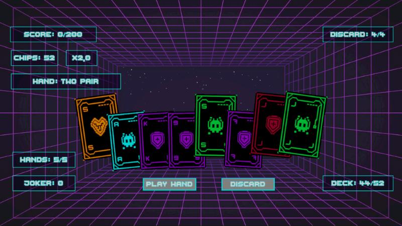
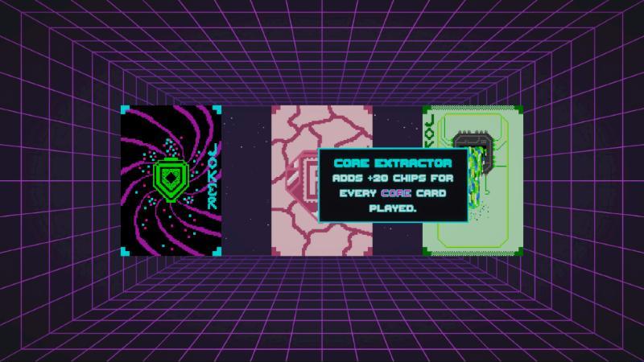
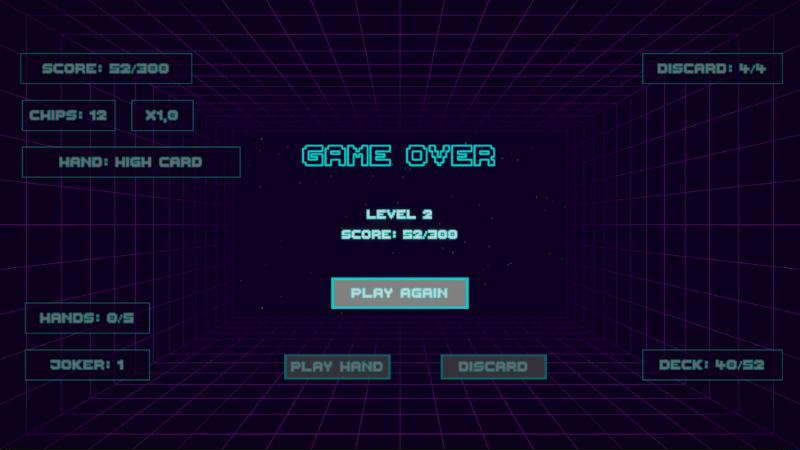
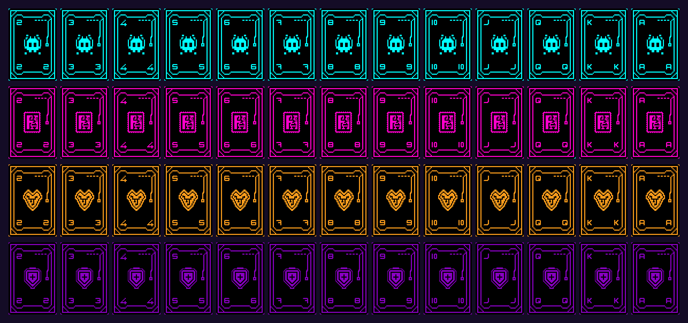
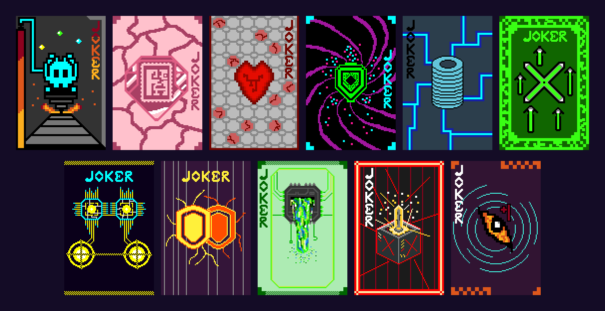

# Cardo

A cyberpunk-themed poker roguelike made with Unity, inspired by *Balatro*.
Build poker hands, beat the score target of each level, and collect jokers that bend the scoring rules.
All 52 cards and 11 jokers are original pixel art, drawn by hand for this game.



## How to play

- You hold **8 cards**. Select up to **5** of them by clicking.
- **Play Hand** scores the selected cards. **Discard** throws them away and draws replacements.
- Each level gives you a limited number of hands and **4 discards**. Reach the level's score target before your hands run out.
- After clearing a level, pick **1 of 3 jokers**. You can hold up to **5**; when you are full, you can swap one of yours for a new one or skip.
- Clear all **10 levels** to win. Run out of hands below the target and the run is over. **Play Again** starts a new run.

The deck has 52 cards in four suits: **Glitch**, **Core**, **Neural** and **Protocol**. It is reshuffled at the start of every level.

**Tips**
- Click the **Deck** counter to see how many cards of each suit are left in the deck.
- Click the **Joker** counter to look at your jokers. Hover a joker to read what it does.



## Scoring

```
score = (hand chips + card values + joker chips) × (hand mult + joker mult)
```

Only the cards that form the hand count. A Pair scores its two cards, and High Card scores only the highest card.
Card values: 2–10 are worth their number, J = 11, Q = 12, K = 13, A = 14.

| Hand | Chips | Mult |
|---|---:|---:|
| High Card | 5 | 1 |
| Pair | 10 | 2 |
| Two Pair | 20 | 2 |
| Three of a Kind | 30 | 3 |
| Straight | 30 | 4 |
| Flush | 35 | 4 |
| Full House | 40 | 4 |
| Four of a Kind | 60 | 7 |
| Straight Flush | 100 | 8 |
| Royal Flush | 100 | 8 |

Straights and flushes need all 5 cards. A-2-3-4-5 counts as a straight.
*Five of a Kind*, *Flush House* and *Flush Five* are also defined, but they cannot be made with the standard 52-card deck.

**Examples**
- Pair of 6s: (10 + 6 + 6) × 2 = **44**
- Flush 4-8-9-Q-A: (35 + 4 + 8 + 9 + 12 + 14) × 4 = **328**

## Levels

| Level | 1 | 2 | 3 | 4 | 5 | 6 | 7 | 8 | 9 | 10 |
|---|---:|---:|---:|---:|---:|---:|---:|---:|---:|---:|
| Score target | 200 | 300 | 400 | 500 | 600 | 700 | 800 | 900 | 1000 | 1100 |
| Hands | 5 | 5 | 4 | 4 | 3 | 3 | 3 | 2 | 2 | 2 |

## Jokers

| Joker | Effect |
|---|---|
| Bit Miner | +20 chips for each scoring Glitch card |
| Core Extractor | +20 chips for each scoring Core card |
| Logic Harvester | +20 chips for each scoring Neural card |
| Void Siphon | +20 chips for each scoring Protocol card |
| Chip Investment | +100 chips |
| The Force Multiplier | +1 mult |
| The Twin Thread | +0.1 mult when the hand is a Pair |
| Dual Layer Proxy | +0.2 mult when the hand is a Two Pair |
| Subnet Overflow | +0.4 mult when the hand is a Flush |
| Mainframe Override | +0.6 mult when the hand is a Full House |
| Expanded Horizon | +1 hand size |



## Art

Every card in the game is hand-drawn pixel art: the full 52-card deck in four suits and all 11 jokers. Each card is 90×135 pixels; the images below show them at 2× scale.





## Getting started

**Requirements:** [Unity Hub](https://unity.com/download) with **Unity 6000.3.0f1** (Unity 6.3). To make builds, also install the *Windows Build Support* or *Web Build Support* module.

1. Clone the repository:
   ```bash
   git clone https://github.com/ibrahimceceli/Cardo.git
   ```
2. In Unity Hub, choose **Add → Add project from disk** and select the `Cardo` folder. The first import takes a few minutes.
3. Open `Assets/Scenes/SampleScene.unity` and press **Play**. A 16:9 Game view (for example 1920×1080) gives the intended layout.
4. To build, open **File → Build Profiles**, pick *Windows* or *Web*, and click **Build**.

The project uses the Universal Render Pipeline, the Input System package, uGUI with TextMesh Pro, and DOTween.

## Project structure

```
Assets/
├── Scenes/SampleScene.unity        The game scene
├── Scripts/
│   ├── HandManager.cs              Hand, selection, scoring, level flow, owned jokers
│   ├── DeckManager.cs              Draw pile, shuffling, spawning cards
│   ├── UIManager.cs                HUD, start screen, joker view, game-over screen
│   ├── JokerSelectionManager.cs    Joker reward screen and joker swapping
│   ├── JokerTooltip.cs             Joker name/description tooltip
│   ├── CardObject.cs               A card in the hand and its selection visuals
│   ├── CardData.cs                 ScriptableObject used for cards and jokers
│   ├── AudioManager.cs             Click sound and music crossfade
│   ├── Services/                   PokerHandEvaluator, HandScoringService
│   ├── Utilities/                  Card fan layout helpers
│   ├── UI/                         Runtime HUD background panels
│   └── CardAssets/                 52 card assets and 11 joker assets
├── Sprites/                        Card, joker and UI art
├── Textures/                       Generated background image
├── Audio/                          Music and sound effects
└── Prefabs/CardPrefab.prefab       The card shown in the hand
Tools/generate_background.py        Script that generates the background (needs Pillow)
```

## Status

Cardo is a playable prototype that is still in active development.

Known limitations:
- The HUD is laid out for 16:9 screens. On 16:10, the *Hands* counter partly overlaps the cards.
- The UI is English only, because the pixel font atlas contains only ASCII characters.
- Mouse input only.

## Credits

- Game design, programming and pixel art (all cards, jokers and suit icons): [ibrahimceceli](https://github.com/ibrahimceceli)
- UI buttons and panels: simple bordered shapes made for this project
- Background: procedurally generated neon grid (`Tools/generate_background.py`)
- Music: "Neon Echo Residue" and "Neon Odds", generated with [Suno](https://suno.com)
- Click sound: "SFX UI Button Click" by suntemple ([Freesound #253168](https://freesound.org/s/253168/))
- Font: [Thaleah Fat](https://tinyworlds.itch.io/free-pixel-font-thaleah) pixel font by Tiny Worlds
- Tweening library: [DOTween](https://dotween.demigiant.com/) by Demigiant
- Built with [Unity](https://unity.com/) and TextMesh Pro

## License

No open-source license has been chosen yet, so all rights are reserved by default.
The card, joker and suit icon artwork is © ibrahimceceli and may not be reused without permission.
